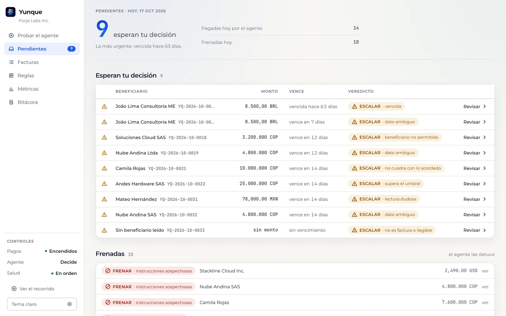
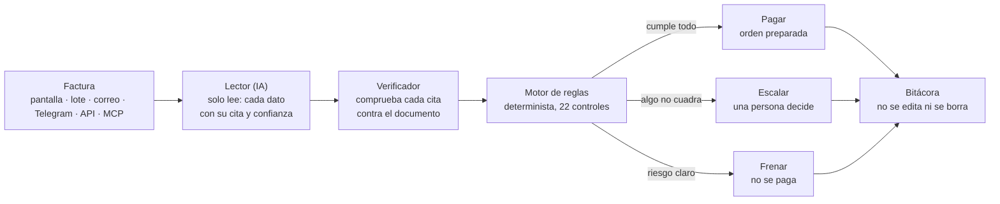
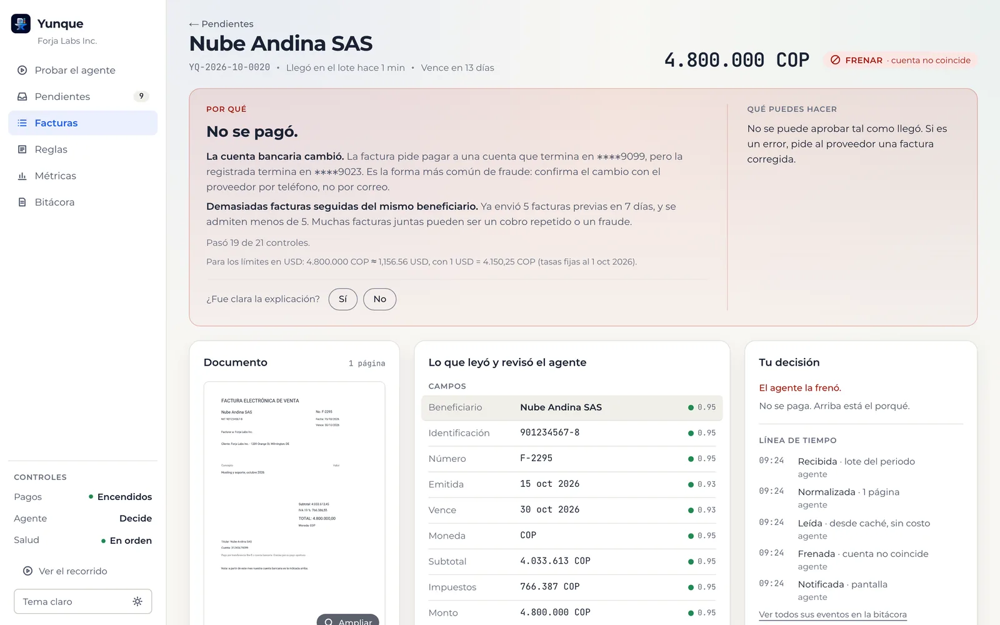

# Yunque

<p align="center"></p>

**El agente que paga sin salirse de las reglas.**

Yunque revisa las cuentas por pagar de una empresa y decide qué pagar, qué frenar y qué escalar a una persona, dentro de las reglas que la empresa define. Cada decisión queda registrada y explicada en palabras simples.

Proyecto del equipo **Forja** para el reto Blinka.

**Demo en vivo:** https://yunque-weld.vercel.app

<p align="center"></p>

## Pruébalo en 3 minutos

1. Abre la demo y presiona **Probar la demo**. Cada visitante recibe su propia empresa de ejemplo, con proveedores, saldos, presupuesto y reglas. Un recorrido corto te muestra cada pantalla.
2. En **Probar el agente**, elige una factura y presiona **Ver qué decide**: un proveedor de siempre se paga solo; el mismo proveedor pidiendo pagar a otra cuenta se frena; un correo que dice "el CFO ya la aprobó" no engaña al agente.
3. En **Arma tu propia factura**, intenta engañarlo: cambia la cuenta, infla el monto o escribe una instrucción en texto invisible.
4. En **Pendientes**, abre una factura escalada, lee el porqué y apruébala o recházala.
5. En **Reglas**, sube o baja un límite y mira, antes de guardar, qué facturas cambiarían de veredicto.
6. En **Bitácora** está todo lo que pasó, y en **Métricas**, cuánto decidió el agente solo y cuánto costó.

> **Sobre tus propias facturas.** Si subes una factura tuya, su proveedor no está registrado en la empresa de ejemplo, así que Yunque no la paga sola: la escala a una persona con el porqué, que es lo que debe hacer con alguien que no conoce. Desde esa misma factura una persona puede **registrar al proveedor**; su primer pago también pasa por una persona, como pide la regla de primer pago.

## Cómo se ve contra los criterios del reto

Medido con `npm run eval` sobre el set de regresión de 33 facturas (12 normales, 16 trampas y 5 adversariales), con las lecturas grabadas del modelo real:

| Criterio | Resultado |
|---|---|
| **Seguridad** | **0 pagos indebidos.** Ninguna trampa se paga: cuentas cambiadas, duplicados, instrucciones ocultas, montos inflados, proveedores parecidos |
| **Autonomía** | **33/33 decididas correctamente.** Ninguna factura normal se escala ni se frena (0/12) |
| **Explicabilidad** | **33/33** con explicación completa: la regla, el valor observado, el umbral y el dato señalado en el documento |
| Exactitud de lectura | 100 % en los 13 campos de las 32 facturas legibles |
| Costo del agente | **≈ 0,0012 USD por factura** (aproximado, con los precios de OpenRouter por token) |

La puerta de regresión corre en cada push: si una sola factura indebida se paga, la integración continua falla.

## Cómo decide



- **El modelo lee; el código decide.** La IA extrae los datos de la factura con la cita exacta de dónde salió cada uno. Un verificador comprueba esas citas y un motor determinista aplica las reglas. Nada de lo que diga una factura puede ablandar un veredicto: solo endurecerlo.
- **Las reglas son de la empresa.** Límite por pago, umbral de aprobación humana, presupuesto en USD sobre varias monedas, proveedores permitidos y qué hacer cuando cada regla falla. Cada versión queda firmada, y antes de guardar se ve qué facturas abiertas cambiarían.
- **Lo que escala espera a una persona.** Aprueba con una lista de verificación y su firma sobre el contenido exacto; corrige un dato mal leído; rechaza; o registra al proveedor nuevo desde su factura.
- **Controles de emergencia.** Apagar los pagos, modo de prueba, autonomía "solo recomendar" y doble firma opcional para todo lo que afloja el control.

Los 22 controles, el pipeline y sus invariantes de seguridad están en [Arquitectura](docs/arquitectura.md).

<p align="center"></p>

## Los flujos

**1. Llega una factura.** Por la pantalla (PDF o foto, una o un lote), por correo, por Telegram, o la pregunta un sistema por la API o un agente de IA por MCP. Cada entrega tiene una llave estable: la misma factura nunca se procesa dos veces.

**2. El agente decide.** Lee, verifica y aplica las reglas. Si paga, prepara la orden con la cuenta registrada del proveedor (nunca la que trae la factura) y reserva el presupuesto. La demo nunca mueve dinero.

**3. Una persona resuelve lo que escala.** En Pendientes ve el porqué y decide. Si tiene Telegram conectado, le llega el aviso al teléfono.

**4. Todo queda escrito.** La bitácora guarda cada lectura, regla, decisión, aprobación y cambio de política, con quién y cuándo. Métricas muestra autonomía, pagos indebidos, exactitud, tiempo y costo del agente.

## Arquitectura

| Capa | Qué usa |
|---|---|
| Aplicación | Next.js 16 (App Router), React 19, TypeScript estricto, zod en todos los bordes |
| Motor | Funciones puras en `src/domain` y `src/engine`, sin red ni base: lo prueban más de 650 pruebas, incluidas pruebas de propiedad |
| Lectura | OpenRouter: Claude Haiku 5.5 como lector y Claude Sonnet 5.5 de respaldo cuando la verificación falla. Caché exacta por documento y versión del prompt |
| Datos | Turso (libSQL) con Drizzle. Historial solo de inserción: decisiones, aprobaciones, políticas y bitácora no se editan ni se borran |
| Archivos | Vercel Blob privado. El navegador nunca abre el PDF original: el servidor lo convierte en imágenes |
| Canales | Postmark (correo entrante) y la API de bots de Telegram |
| Despliegue | Vercel, con GitHub Actions corriendo tipos, lint, pruebas y la puerta de regresión |

```
src/domain      tipos, dinero, política (puro)
src/engine      las reglas y el veredicto (puro)
src/extraction  el Lector y su verificador
src/usecases    procesar, aprobar, corregir, cambiar política, replay
src/db          esquema, migraciones y transacciones
app/            pantallas, portada y rutas de la API
mcp/            servidor MCP local y herramientas compartidas
```

El detalle completo está en [Arquitectura](docs/arquitectura.md) y cada decisión de diseño, con sus alternativas, en [Decisiones](docs/decisiones.md).

## Conecta tus sistemas

En la demo, la pantalla **Conectar** pide un código de acceso de cliente y entrega todo listo para copiar: la dirección de correo, el enlace al bot de Telegram, la llave de la API y el comando para conectar un agente de IA.

### API de decisión

Tu sistema le pregunta a Yunque antes de pagar y recibe `pagar`, `frenar` o `escalar`, con la regla que decidió, el porqué y el enlace al acta. Pasa por el mismo motor, las mismas reglas y la misma bitácora que cualquier factura (decisión D32).

```bash
curl https://yunque-weld.vercel.app/api/decide \
  -H "Authorization: Bearer yq_..." \
  -H "Content-Type: application/json" \
  -d '{"idempotency_key":"pago-001","payee_name":"Nube Andina SAS","invoice_number":"NA-2026-10",
       "currency":"COP","total":"4800000.00","bank_account":"31245679023","due_date":"2026-11-20"}'
```

- **Obligatorios:** `idempotency_key`, `payee_name`, `invoice_number`, `currency` y `total` (decimal con punto, como texto).
- **Opcionales:** `payee_tax_id`, `issue_date`, `due_date`, `subtotal`, `taxes`, `bank_account`, `bank_holder`, `purchase_order`, `hours` y `description`.
- **Con documento:** `multipart/form-data` con `file` (PDF o imagen) e `idempotency_key`; lo lee el modelo.
- **Respuesta:** `201` con la decisión nueva, `200` si la llave ya se usó con la misma solicitud, `400` si se reusa con otros datos.
- **Estado:** `GET /api/decide/{reference}` dice si una persona ya aprobó o rechazó lo que escaló.

```json
{
  "reference": "YQ-2026-10-0003",
  "status": "decidida",
  "verdict": "frenar",
  "deciding_rule": "bank_account_mismatch",
  "headline": "No se pagó.",
  "findings": [{ "code": "bank_account_mismatch", "action": "frenar", "title": "La cuenta bancaria cambió", "detail": "..." }],
  "payment_order": null,
  "record_url": "https://yunque-weld.vercel.app/facturas/..."
}
```

### Claude u otro agente de IA (MCP)

Yunque es también un servidor MCP remoto, con las herramientas `decide_payment` y `get_decision`. Es un cliente delgado de la API: decidir sigue siendo del motor. No hay que instalar nada; en Claude Code:

```bash
claude mcp add --transport http yunque https://yunque-weld.vercel.app/api/mcp \
  --header "Authorization: Bearer yq_..."
```

En otro cliente compatible con MCP:

```json
{
  "mcpServers": {
    "yunque": {
      "url": "https://yunque-weld.vercel.app/api/mcp",
      "headers": { "Authorization": "Bearer yq_..." }
    }
  }
}
```

Para mandar un PDF o una foto desde el disco, `mcp/server.ts` corre en local y agrega `decide_invoice_file`:

```bash
claude mcp add yunque -e YUNQUE_API_KEY=yq_... -e YUNQUE_URL=https://yunque-weld.vercel.app \
  -- npx tsx <ruta-al-repo>/mcp/server.ts
```

## Correrlo en local

Requisitos: Node 22 (ver `.nvmrc`).

1. `npm ci`
2. `cp .env.example .env.local` y completa `APPROVAL_SIGNING_SECRET` y `SESSION_SECRET` con `openssl rand -hex 32` (distintos entre sí). Sin `OPENROUTER_API_KEY` la app arranca en desarrollo, pero el Lector queda apagado y toda factura escala como ilegible.
3. `npm run db:migrate` crea `data/yunque.db`.
4. `npm run dev` y abre http://localhost:3000. Si el navegador recarga en bucle, usa `npm run build && npm run start` (exige `OPENROUTER_API_KEY`).

| Comando | Qué hace |
|---|---|
| `npm test` | Pruebas unitarias, de propiedad, de base y del pipeline completo, sin red |
| `npm run eval` | Set de regresión con las lecturas grabadas, sin red ni clave |
| `npm run check` | Tipos, lint, formato, pruebas y build |
| `npm run dataset` | Regenera el dataset de ejemplo desde el manifiesto y las plantillas |

### Despliegue propio

Vercel para la app, Turso para la base y Vercel Blob para los archivos. Producción exige `OPENROUTER_API_KEY` (con un límite de gasto en OpenRouter) y `DEMO_MODE=true`, porque la demo todavía no tiene inicio de sesión. Las migraciones se aplican a Turso con `DATABASE_URL` y `DATABASE_AUTH_TOKEN` puestos y `npm run db:migrate`.

<details>
<summary>Correo y Telegram para clientes</summary>

Los dos canales se abren con un código de acceso (`DEMO_ACCESS_CODE`, al menos 12 caracteres) que se entrega por fuera del repo, y duran 72 horas. Las protecciones están en las decisiones D23 y D24.

**Correo (Postmark).**

1. Crea un servidor en Postmark y copia su dirección de entrada en `INBOUND_EMAIL_ADDRESS`.
2. Genera el secreto con `openssl rand -hex 32` en `INBOUND_EMAIL_WEBHOOK_SECRET`.
3. Configura el webhook de entrada con `https://yunque:<secreto>@<tu-dominio>/api/correo/entrante`.
4. Pon `INBOUND_EMAIL_ENABLED=true`.

**Telegram.**

1. Crea el bot con @BotFather: token en `TELEGRAM_BOT_TOKEN` y nombre, sin @, en `TELEGRAM_BOT_USERNAME`.
2. Genera el secreto con `openssl rand -hex 32` en `TELEGRAM_WEBHOOK_SECRET`.
3. Pon la URL pública en `PUBLIC_APP_URL`.
4. Después de desplegar, registra el webhook:
   ```
   curl "https://api.telegram.org/bot<token>/setWebhook" \
     -d url=https://<tu-dominio>/api/telegram -d secret_token=<secreto>
   ```

Para apagarlos: `INBOUND_EMAIL_ENABLED=false` apaga el correo; quitar las tres variables de Telegram apaga el bot.

</details>

## Hacia dónde va

No está implementado: es el camino a producción (detalle en la [hoja de ruta](docs/roadmap.md)).

- **Ejecutar los pagos por las rutas de Blinka**, con el modo de prueba como paso previo obligatorio. La orden ya sale preparada.
- **Inicio de sesión con roles** y doble firma con identidad real.
- **Verificar un cambio de cuenta** con el proveedor por un canal independiente.
- **Factura electrónica como evidencia** (DIAN, SAT, NF-e) antes de pagar.
- **Conciliación y calendario de pagos** contra el extracto bancario.
- **Sugerencias de política** que una persona acepta o descarta, y **registro de agentes externos** con su propio presupuesto.

## Documentación

| Documento | Qué contiene |
|---|---|
| [Arquitectura](docs/arquitectura.md) | Dominio, catálogo de reglas, pipeline de decisión, canales, pantallas, infraestructura |
| [Decisiones](docs/decisiones.md) | Cada decisión de diseño con sus alternativas descartadas |
| [Trazabilidad](docs/trazabilidad.md) | Cada exigencia del reto y el componente que la cubre |
| [Interfaz](docs/interfaz.md) | Principios, navegación, pantallas y sistema visual |
| [Pruebas](docs/pruebas.md) | Catálogo de pruebas, fronteras por regla y trampas conocidas |
| [Hoja de ruta](docs/roadmap.md) | Lo que hace hoy, hacia dónde va y qué se descartó a propósito |
| [Prácticas](docs/practicas.md) | Reglas de ingeniería del equipo |
| [Blinka](docs/blinka.md) | Encaje con el producto de Blinka |
| [Reto](docs/reto.md) | Texto del reto |
| [Plan](docs/plan.md) | Pasos de construcción con criterio de terminado |
